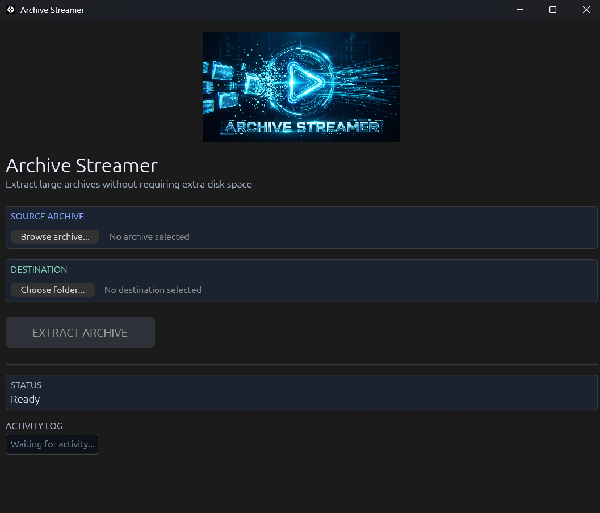

# Archive Streamer

**Extract large archives with less temporary disk space.**

Archive Streamer is a Windows application designed to extract large archives when available disk space is limited. It provides both a command-line interface (CLI) and a graphical user interface (GUI).

<p align="center">
  
</p>

Instead of relying on a conventional extraction workflow that keeps the entire source archive intact until extraction finishes, Archive Streamer uses a streaming approach and can reclaim storage occupied by already-consumed portions of the source archive on supported filesystems.

> **Important:** Archive Streamer is destructive by design. The source archive may be modified during extraction, and the original archive is deleted after successful extraction. Always keep a backup if you need to preserve the original.

## Features

- **Streaming extraction** — processes archive data incrementally.
- **Reduced temporary disk-space requirements** — can reclaim space from the source archive as data is consumed, where supported.
- **CLI support** — run extraction from CMD, PowerShell, or scripts.
- **GUI support** — select an archive and destination using a graphical interface.
- **Progress and status reporting** — view extraction activity and errors.
- **Windows installers** — install the CLI and GUI separately.
- **Optional PATH integration** — make the CLI available from any terminal.
- **Desktop shortcut and application icon** — available with the GUI installer.

## How It Works

Traditional extraction can require enough free disk space to hold both the compressed archive and the extracted contents simultaneously.

Archive Streamer uses a streaming reader that processes archive data progressively. On supported filesystems, consumed regions of the source archive can be released to reclaim disk space while extraction continues.

The amount of space recovered depends on the archive format, compression method, filesystem, and extraction pattern. This approach does not guarantee that every archive can be extracted when its uncompressed size exceeds the available disk space.

## Supported Platforms

- Windows — GUI and CLI installers.
- Linux — CLI builds may be possible, depending on platform-specific implementation and dependencies.

Filesystem-specific space reclamation is platform-dependent. Verify support and test with disposable archives before relying on it for important data.

## Installation

Download the appropriate installer from the project's **GitHub Releases** page.

### CLI

Run the CLI installer and optionally select **Add Archive Streamer CLI to PATH**.

After installation, open a new CMD or PowerShell window.

Check that the command is available:

```powershell
archive-streamer-cli.exe
```

### GUI

Run the GUI installer and launch **Archive Streamer** from the Start Menu or Desktop shortcut.

Select the source archive, choose the destination folder, and start extraction.

## CLI Usage

```powershell
archive-streamer-cli.exe "C:\Archives\large-archive.zip" "D:\Extracted"
```

Arguments:

| Argument | Description |
|---|---|
| `archive` | Path to the source archive |
| `destination` | Directory where files will be extracted |

Quote paths that contain spaces.

## Build from Source

Install Rust and Cargo, then clone the repository:

```powershell
git clone https://github.com/cvija1/archive-streamer.git
cd archive-streamer
```

### Build the CLI

```powershell
cargo build --release --no-default-features --bin archive-streamer-cli
```

### Build the GUI

```powershell
cargo build --release --no-default-features --features gui --bin archive-streamer-gui
```

The release binaries are generated in:

```text
target/release/
```

The GUI build requires the project's GUI dependencies and any native build dependencies required by the selected configuration.

## Safety Notice

Archive Streamer is intended for users who understand the risks of destructive streaming extraction.

- **Back up important archives before use.**
- Do not interrupt extraction unless you understand the consequences.
- Ensure the destination has enough space for the files being extracted.
- Use a disposable test archive when evaluating the application.
- Test filesystem and archive-format compatibility before processing valuable data.

The source archive may become unusable before extraction completes if an error or interruption occurs. Do not treat the original archive as a recoverable backup.

## Contributing

Issues, bug reports, feature requests, and pull requests are welcome.

When reporting a problem, include:

- Operating system and filesystem.
- Archive format and approximate size.
- Available disk space.
- The command or steps used.
- Relevant error messages or logs.

Please do not upload private or sensitive archive contents when reporting issues.

## License

This project is licensed under the MIT License. See the LICENSE file for details.

---
